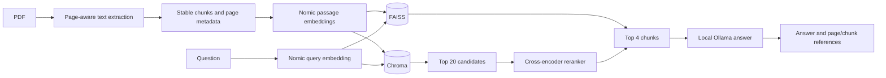

# PageTrace

**PDF retrieval, reranking, and cited local answers.**

An offline-capable, single-document question-answering project built to expose the decisions behind retrieval-augmented generation (RAG). It has two working retrieval paths: a small FAISS pipeline for inspecting embeddings and matches, and a Chroma pipeline that retrieves more candidates and reranks them before asking a local Ollama model to answer. The code is intentionally CLI-first so the ingestion, retrieval, and generation stages are visible.

## What is implemented

| Stage | FAISS path | Chroma + reranker path |
| --- | --- | --- |
| PDF ingestion | `pypdf` layout extraction, Unicode normalization, whitespace cleanup | Same page-aware loader |
| Chunking | Recursive text splitting, 500 characters with 50 overlap; stable content-hash/page/chunk IDs | Same chunks |
| Embeddings | Nomic `passage` prompt for chunks, `query` prompt for questions | Same model and asymmetric prompts |
| First-stage retrieval | Normalized vectors in `IndexFlatIP`; top 4 cosine matches | Persistent Chroma collection; top 20 candidates |
| Reranking | None | Cross-encoder scores candidate question/chunk pairs; top 4 survive |
| Answering | Local Ollama `gemma4:e2b-mlx`, with retrieved context and chunk citations | Same answer prompt, with reranked context |
| Persistence | `faiss.index` and `chunks.pkl`; a new load replaces the old PDF | `.chroma/`; collection identity includes path, PDF hash, model, and chunk settings |



The split between `passage` and `query` prompts matters because the embedding model was trained for those roles. Normalizing FAISS vectors makes inner product act as cosine similarity. Chroma's candidate stage is deliberately broad; the cross-encoder then scores each question/chunk pair more precisely. A rerank score is a model score, not a probability or cosine similarity.

## Run it locally

Use Python 3.12 and a local Ollama installation. Model downloads require internet the first time. Commands below are from this directory:

```sh
python3.12 -m venv .venv
.venv/bin/python -m pip install -r requirements.txt
ollama pull gemma4:e2b-mlx
```

Ollama must be running on `127.0.0.1:11434` (`ollama serve` if it is not already running). Start with a text-based PDF you have permission to use:

```sh
.venv/bin/python loader.py /absolute/path/to/document.pdf
.venv/bin/python query.py "What are the main findings?"
.venv/bin/python chatbot.py
```

`loader.py` prints the embedding shape and writes `faiss.index` plus `chunks.pkl`. `query.py` shows rank, cosine score, page, chunk, and text preview. `chatbot.py` retrieves four chunks, also includes the PDF's first chunk as cover context, and answers using the local Ollama model. Type `quit` to leave. Each question is independent; this is document QA, not a conversation-memory system.

For the second retrieval path, run:

```sh
.venv/bin/python baseline_rag.py /absolute/path/to/document.pdf
```

The first run creates a Chroma collection and downloads the Nomic embedding model and `cross-encoder/ms-marco-MiniLM-L6-v2`. Later runs reuse a complete collection for the same PDF and settings. Changed PDF contents get a different collection. The terminal prints the answer followed by the exact page and chunk references supplied to the model. To ask a new question, type it at the prompt.

## Code map

- [`loader.py`](loader.py): PDF extraction, stable chunk IDs, Nomic embeddings, FAISS index creation.
- [`query.py`](query.py): search the FAISS index and inspect retrieved evidence.
- [`chatbot.py`](chatbot.py): offline FAISS retrieval and local answer loop.
- [`baseline_rag.py`](baseline_rag.py): persistent Chroma indexing, 20-candidate retrieval, cross-encoder reranking, local answer loop.
- [`answer.py`](answer.py): shared grounded prompt, Ollama request, chunk-number citations.
- [`test_baseline_rag.py`](test_baseline_rag.py): checks reuse/repair of an index, reranking order, citation context, and a missing-PDF error.

Run the focused tests with `.venv/bin/python -m unittest -v test_baseline_rag.py`. They mock the model and Ollama, so they verify pipeline logic without downloading model weights.

## Design boundaries

This is a local research prototype, not a hosted service. A FAISS load supports one PDF at a time and replaces its prior index; Chroma keeps separate collections per PDF identity. The answer prompt asks the model to abstain and cite chunks, but citations are **not independently verified** and answer quality has not been benchmarked against a question set. Scanned PDFs need OCR before ingestion. `chunks.pkl` uses Python pickle: load only files you created or trust. The embedding model runs with `trust_remote_code=True`, so inspect the model repository before first download. The FAISS chatbot requires model weights already cached because it sets Hugging Face offline mode; the other scripts can download them on first run.

The next meaningful improvement would be a small evaluation set with answer, citation, and abstention checks; that would show whether reranking improves this corpus rather than merely adding another component.
